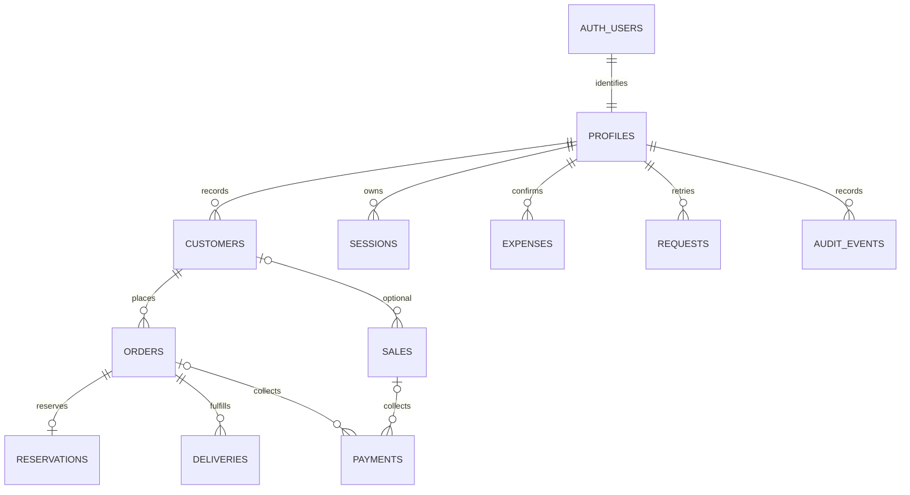

# Backend contract and schema

All app RPCs require a managed JWT and current active protected profile. `aq_me()` returns that account only. `aq_query(p_request jsonb)` and `aq_command(p_request jsonb)` derive actor/time, validate keys and return JSON objects; no client actor/price overrides. Mutations require UUID `request_id`: identical actor/key/payload returns the original result; changed payload conflicts. Keep a key when response is uncertain. Records are not saved by prediction or a UI preview.

Queries: me; customers(search), customer(id); orders(status/customer_id/search/unpaid_only), order(id/reference); sales/sale; payments; inventory/home; Owner-only expenses(start_date/end_date/category), report/dashboard(start_date/end_date), staff. Expense list returns items and total_centavos. Report returns station, start_date/end_date, generated_at, revenue_centavos, payments_received_centavos, expenses_centavos, net_income_centavos, outstanding_centavos, calculation and timezone. Preserve the same immutable response for preview/PDF.

Commands: create_customer/update_customer (id for update, name/customer_type/contact_number/address); create_order(customer_id,quantity,business_date); transition_order(order_id,status); record_pickup(order_id,quantity); reschedule_pickup(order_id,scheduled_date); record_delivery(order_id,quantity); create_sale(customer_name, optional customer_id,quantity,cash_centavos,confirm_credit); record_payment(reference,amount_centavos); Owner create_expense(business_date,category,amount_centavos,remarks,selection_source,optional accepted_model_version); update_profile(full_name,username,contact_number).

Types: UUID identifiers, dates ISOYYYY-MM-DD (Asia/Manila), timestamptz immutable server times, positive integer gallons, bigint centavos. Household/walk_in price3500; dealer3000. Status strings are lower_snake_case; payment status is derived paid/partially_paid/unpaid. Quantities distinguish expected, collected, adjusted, delivered, pending and reserved. Delivery consumes its order reservation; POS consumes only physical filled minus all active reservations. Single transactional functions lock inventory/order rows and serialize mutations; session locks prevent first-request session races.

Private tables (no client table/schema grants; RLS default deny):

| Table | Keys and meaning |
|---|---|
| profiles | Auth user_id PK/FK; unique normalized username, full_name, 11digit contact, owner/staff role, active |
| sessions | managed session_id PK, user_id, backend last_seen_at enforcing30minute idle |
| customers | UUID PK; name/type/unique11digit contact/address, recorder/time |
| orders | UUID/reference unique; customer snapshot, business_date, expected/adjusted/collected/delivered, fixed price/status/rescheduled_date |
| inventory | singleton; empty_quantity, physical_filled, initialized, updated_at |
| reservations | order_id PK/FK, remaining reserved filled quantity |
| deliveries | UUID, order_id, per-trip quantity, server time/recorder |
| sales | UUID/reference, optional customer, required name, quantity/fixed price, tendered/change, time/recorder |
| payments | UUID/reference, exactly one order_id/sale_id, positive retained centavos, receipt time/recorder |
| expenses | UUID/reference, business_date, fixed category, amount, bounded remarks, selection source/accepted version |
| requests | actor_id/request_id composite PK, exact payload/result for retries |
| audit_events | server actor/action/entity/request/before/after/reason/time; no app edit/delete grants |
| login_windows | bounded HMAC alias/source rate-limit buckets (no raw names/IPs) |
| account_operations | request_id, actor, operation/payload hash, pending/completed result for Auth reconciliation |
| account_audit | immutable ordinary-app account mutation evidence |

Edge username-login accepts username/password only; uses service-only alias mapping then real Auth. Staff-admin accepts strict operation/request_id/profile fields; Owner AAL2 required by checked SQL. Create uses stable internal email derived from request ID for unknown-outcome reconciliation; never retry an uncertain creation with another key. No public signup/recovery menu. Hosted Auth signature/MFA/config and APK behavior require development integration tests; SQL JWT stubs are only local enforcement tests.
